# SortWise

**Desktop buried in screenshots? Downloads full of `Document3.docx`, `Book1.xlsx` and five copies of the same photo? Those days are over.**

Point SortWise at any folder and press **Sort this folder**. It reads what every file is about, not just its type, and puts each one where it belongs: into the folder you already have for that subject, or into a new one it creates, with folders inside folders when a subject is big enough. Then it keeps watching, so every new download and saved file lands in the right place by itself.

Works on Windows and Mac. Everything happens on your own computer.

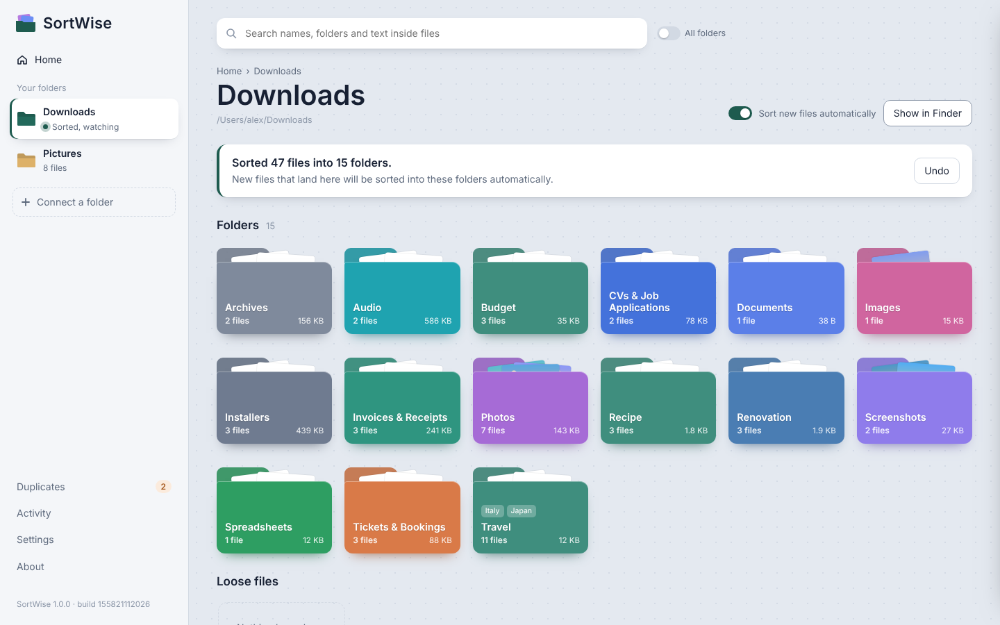

## Download
Get the latest build from **[Releases](https://github.com/theganeshlife/SortWise/releases/latest)**.

| | |
|---|---|
| Windows installer | `SortWiseSetup-1.0.0.exe` |
| Windows, no install | `SortWise-1.0.0-portable.exe` |
| Mac with Apple silicon (M1 and later) | `SortWise-1.0.0-mac-apple-silicon.dmg` |
| Mac with Intel | `SortWise-1.0.0-mac-intel.dmg` |

The first time you open SortWise:
- **Windows:** choose **More info › Run anyway**.
- **Mac:** go to **System Settings › Privacy & Security › Open Anyway**.

The **[user guide](docs/GUIDE.md)** explains every screen and how SortWise decides where things go.

## What it does
- **Sorts by subject, not just by type.** A Word file, a PDF and a slide deck about the same trip end up together.
- **Uses the folders you already have.** It matches new files to folders by what's inside them, going as deep as the match holds.
- **Builds folders inside folders,** for example *Travel › Japan › Kyoto*.
- **Keeps it that way.** New files are put in place within seconds of arriving.
- **Clears duplicates.** Photos, videos, documents and whole folders are shown side by side; you choose what to keep.
- **Finds anything.** Search covers names, folders, the text inside documents, and your own tags and notes.
- **Undoes anything.** Every move can be put back in one click.

## Screenshots

**Home.** Everything at a glance: what's been sorted, what's waiting, duplicates and your folders.
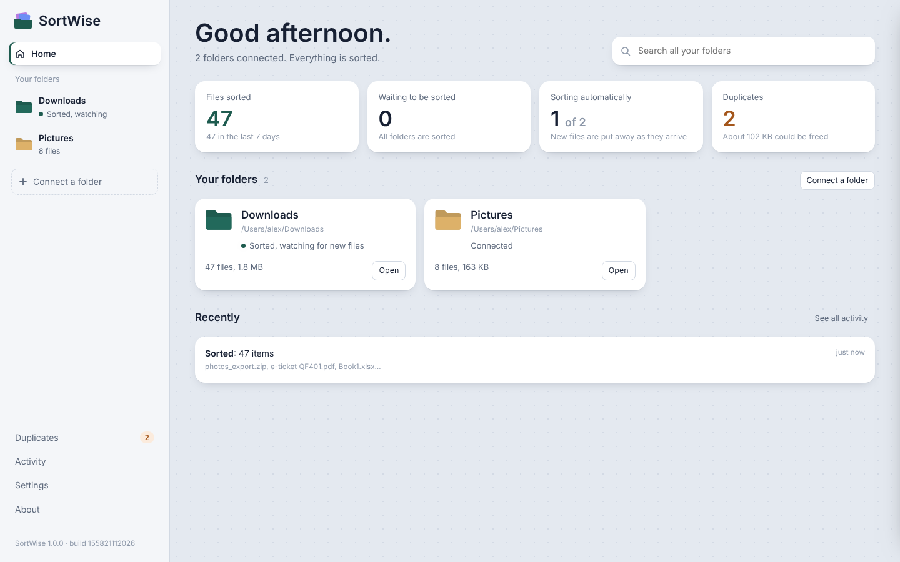

**Before.** Loose files scattered across Downloads.
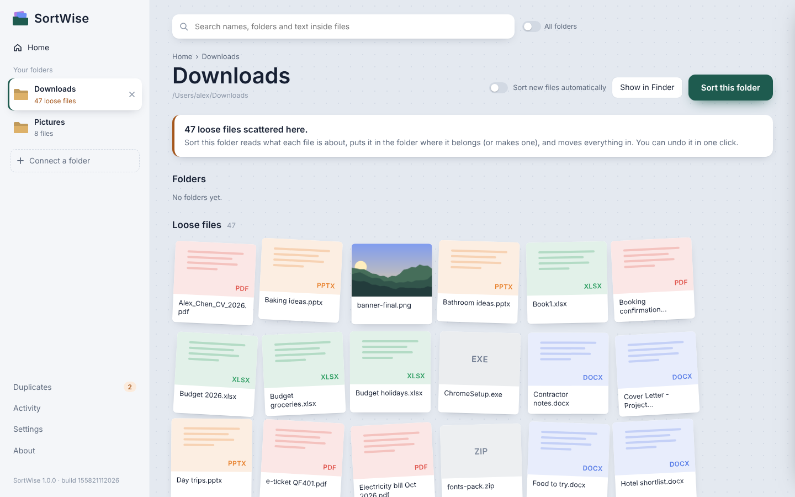

**Sort this folder.** Folders appear and each file flies into place.
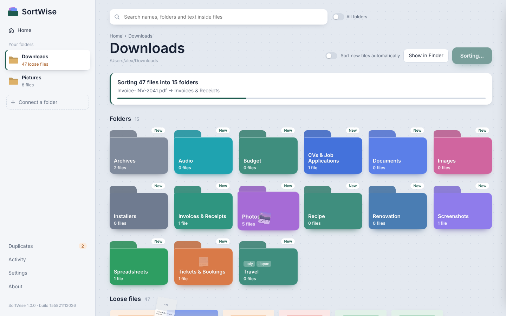

**Folders inside folders,** worked out from the text inside the files.
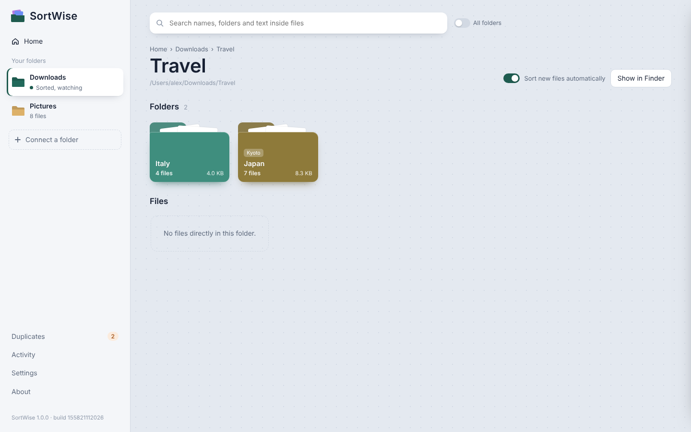

**Search,** including the text inside documents.
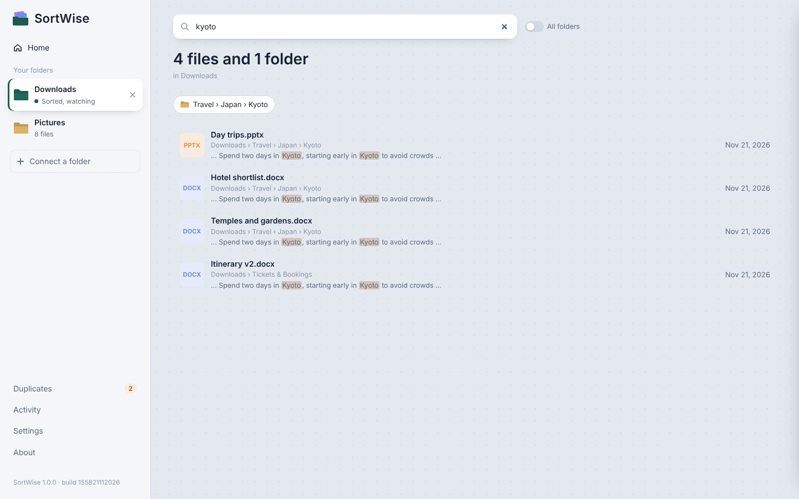

**Preview, rename and tag** any file.
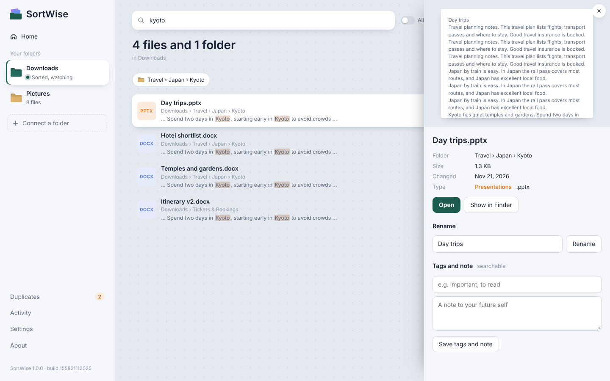

**Duplicates,** side by side.
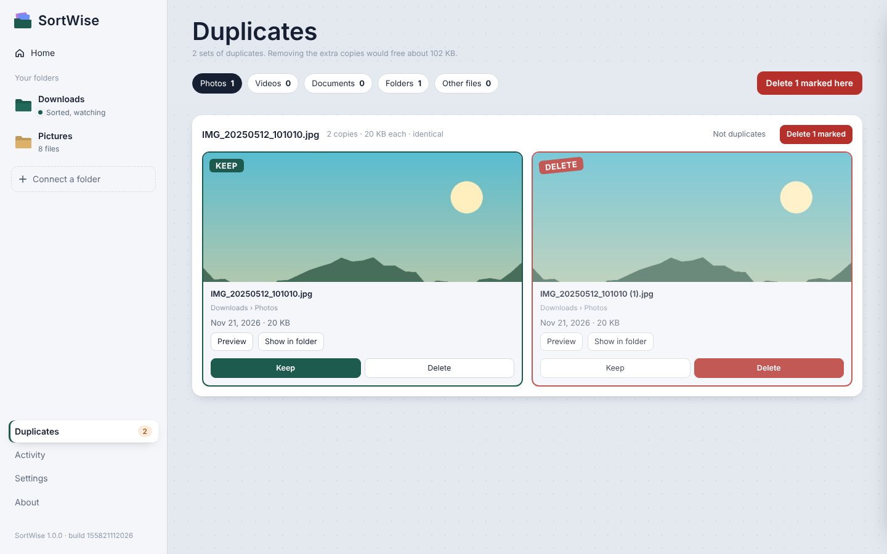
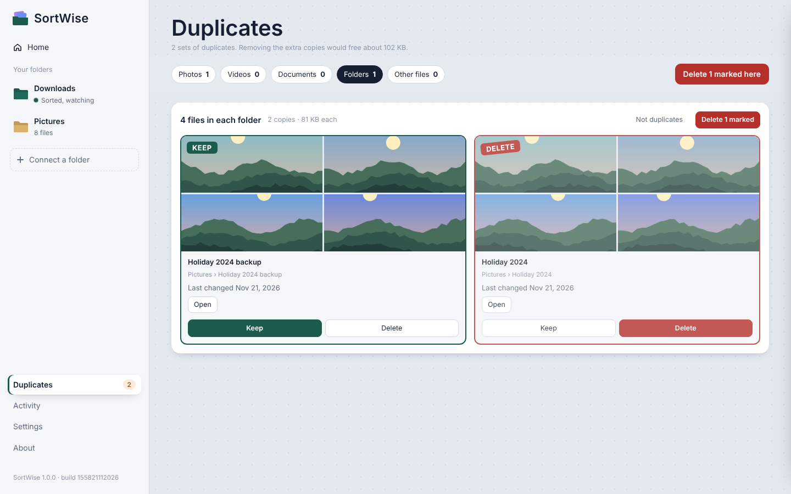

**Activity with undo.**
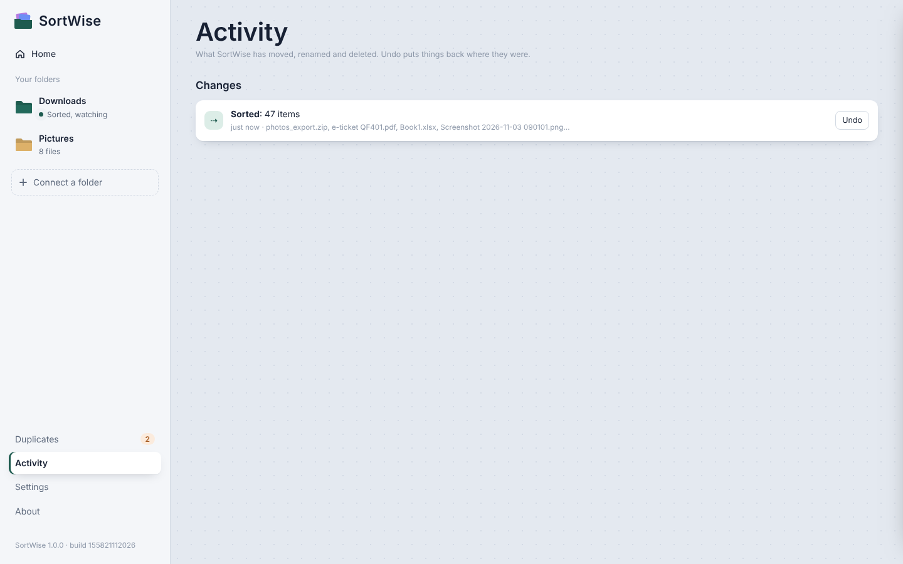

**Settings.**
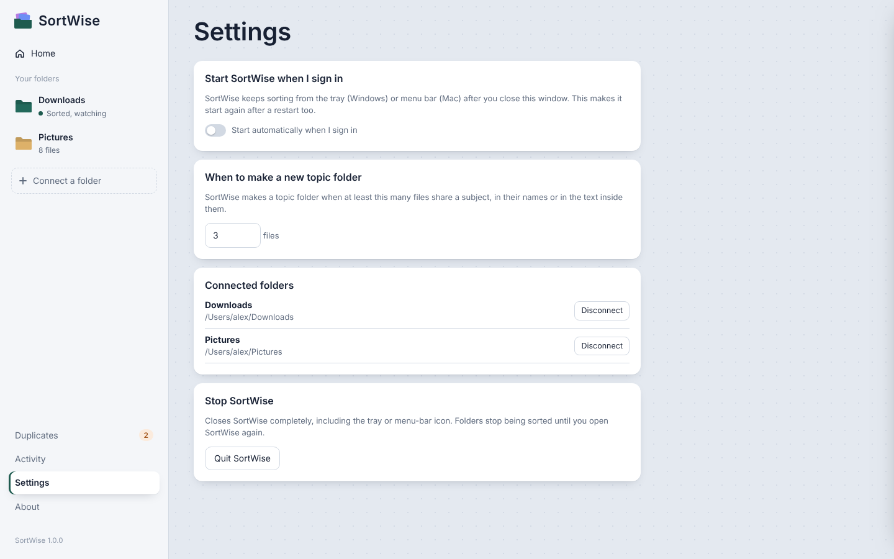

**About, with one-click updates.**
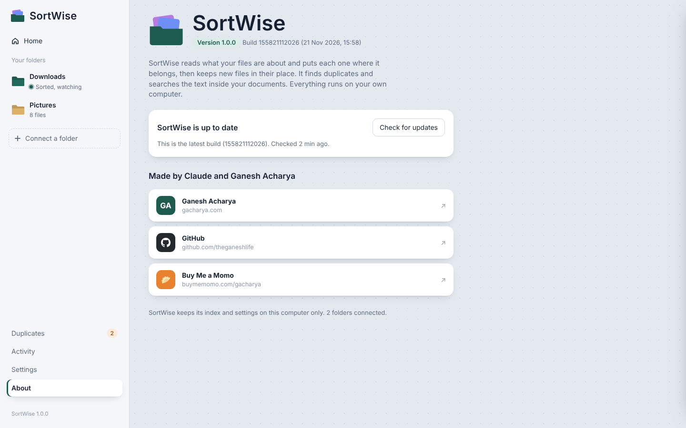

**Dark mode** follows your system.
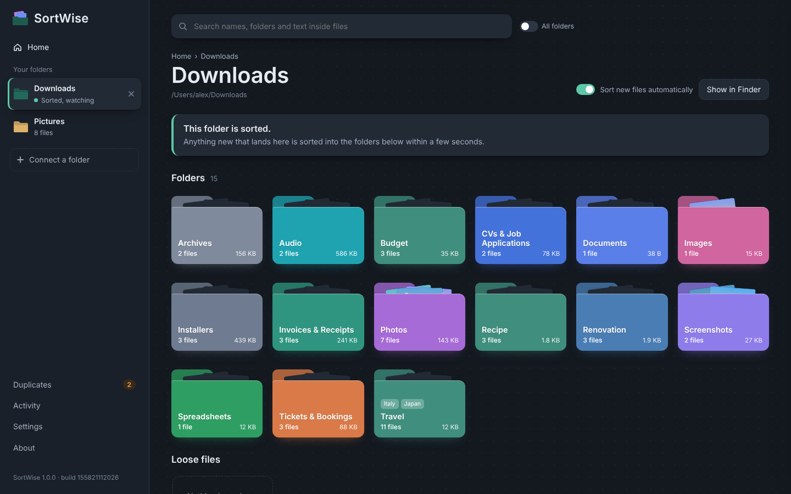

## Updates
**About › Check for updates** installs new builds in place, and your folders and settings are kept. Build numbers are the publish time (Sydney) as `HHMMDDMMYYYY`. For example, `155821112026` is 15:58 on 21 November 2026.

## Credits
SortWise is made by Claude and Ganesh Acharya.
[gacharya.com](https://gacharya.com/) · [GitHub](https://github.com/theganeshlife) · [Buy Me a Momo](https://buymemomo.com/gacharya)

## License
[MIT](LICENSE)
