# SortWise user guide

This guide covers everything SortWise does and where to find it. For a quick overview, see the [README](../README.md).

- [Install](#install)
- [The SortWise window](#the-sortwise-window)
- [Home](#home)
- [Connecting folders](#connecting-folders)
- [Sort this folder](#sort-this-folder)
- [How SortWise decides where a file goes](#how-sortwise-decides-where-a-file-goes)
- [Sorting new files automatically](#sorting-new-files-automatically)
- [Browsing, previewing and renaming](#browsing-previewing-and-renaming)
- [Tags and notes](#tags-and-notes)
- [Search](#search)
- [Duplicates](#duplicates)
- [Activity and undo](#activity-and-undo)
- [Settings](#settings)
- [About and updates](#about-and-updates)
- [The tray and menu-bar icon](#the-tray-and-menu-bar-icon)
- [Privacy and safety](#privacy-and-safety)
- [Uninstalling](#uninstalling)
- [Troubleshooting](#troubleshooting)

---

## Install

Download from [Releases](https://github.com/theganeshlife/SortWise/releases/latest).

| File | Use it for |
|---|---|
| `SortWiseSetup-1.0.0.exe` | Windows 10 and 11. Installs for your account only, so no admin rights are needed. |
| `SortWise-1.0.0-portable.exe` | Windows, without installing. Keep it anywhere and double-click it. |
| `SortWise-1.0.0-mac-apple-silicon.dmg` | Macs with an M-series chip (M1, M2, M3 and later). |
| `SortWise-1.0.0-mac-intel.dmg` | Older Macs with an Intel processor. |

**Windows.** Run the installer. It offers two options:
- **Put a SortWise shortcut on the Desktop.**
- **Start SortWise when I sign in**, so new files keep getting sorted after a restart. You can change this later in Settings.

The app isn't code-signed, so Windows SmartScreen may say *Windows protected your PC*. Choose **More info**, then **Run anyway**. You only need to do this once.

**Mac.** Open the .dmg and drag **SortWise** into **Applications**. The first time you open it, macOS says it can't check the app. Go to **System Settings › Privacy & Security**, scroll down and choose **Open Anyway**. When SortWise first touches Downloads, Desktop or Documents, macOS asks for permission; choose **Allow**.

---

## The SortWise window

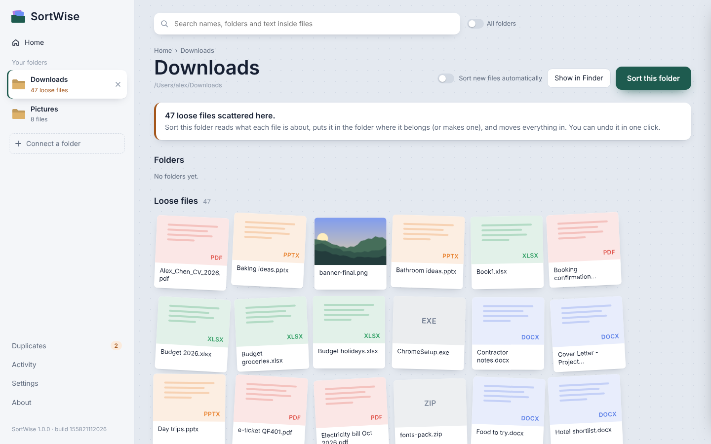

- **Left side.** **Home** is at the top; clicking the SortWise logo also takes you there. Below it are your folders: every folder you've connected, with a status line under each:
  - *N loose files* (orange) means there are files scattered at the top of the folder.
  - *Sorted, watching* (with a green dot) means the folder has been sorted and new files are sorted automatically.
  - *N files* means it's connected but isn't being sorted automatically.
- **Bottom left:** Duplicates (with a count), Activity, Settings, About, and the version and build number.
- **Where you are:** the page you're on is highlighted in the sidebar with a green bar, and inside a folder the path at the top starts from Home (for example *Home › Downloads › Travel*). Click any part of the path to go back to it.
- **Main area:** the folder you're looking at.
  - **Folders** are shown as coloured folder shapes. Type folders have a fixed colour each (PDFs red, Photos purple, Spreadsheets green and so on). Topic folders get their own colours. Photos peek out of the top of folders that contain them.
  - **Loose files** sit underneath as paper slips, with picture thumbnails for images.
- **Top:** the search box, and the **All folders** switch for searching every connected folder at once.

Press `/` anywhere to jump to the search box, and `Esc` to close a preview.

---

## Home

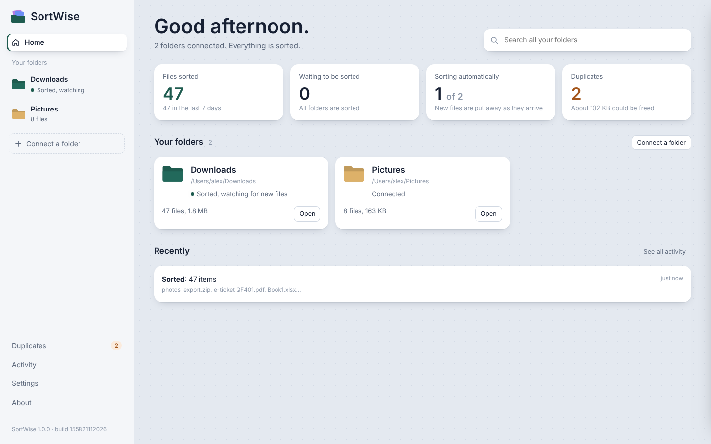

SortWise opens on **Home**, an overview of everything it looks after:
- **Files sorted:** how many files SortWise has put away, and how many in the last 7 days. Click it to open Activity.
- **Waiting to be sorted:** loose files across your folders. Click it to open the first folder that needs sorting.
- **Sorting automatically:** how many of your folders sort new files as they arrive.
- **Duplicates:** how many sets of copies were found and how much space removing them would free. Click it to open Duplicates.
- **Your folders:** a card for each connected folder with its status, size and number of files. **Open** shows the folder; **Sort this folder** appears when it has loose files.
- **Recently:** the last few sorts, renames and clean-ups, with a link to all activity.
- **Search all your folders:** type and press Enter to search everything you've connected.

---

## Connecting folders

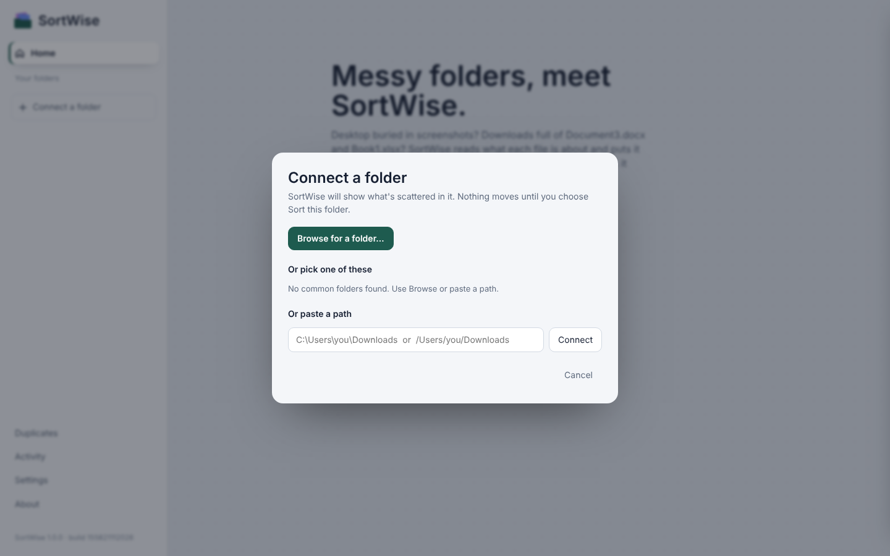

Click **Connect a folder**, then either:
- **Browse for a folder…** to open the standard folder picker,
- pick one of the **suggestions** (Desktop, Downloads, Documents, Pictures and your OneDrive folders), or
- **paste a path**, such as `C:\Users\you\Downloads` or `/Users/you/Downloads`.

Connecting a folder doesn't move anything. SortWise reads it first: file names, sizes, and the text inside documents. That's what makes search and sorting by subject work. A large folder can take a few minutes the first time; progress shows at the bottom left.

You can connect any folder except a whole drive or your entire user folder. Folders inside OneDrive, Dropbox or iCloud Drive work too.

**Disconnecting.** Hover over a folder on the left and click **✕**, or use **Settings › Connected folders**. SortWise stops showing and sorting it. Your files stay exactly where they are.

---

## Sort this folder

When a folder has loose files, a green **Sort this folder** button appears at the top.

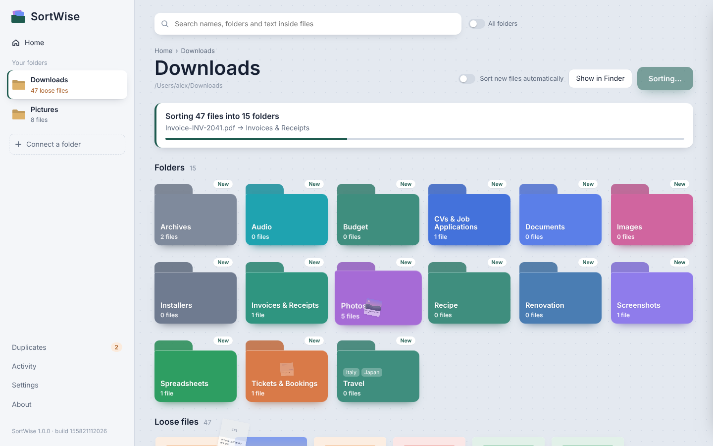

Click it and watch:
1. SortWise reads every loose file and works out where it belongs.
2. Any new folders appear on the shelf, marked **New**.
3. Each file flies into its folder while a progress bar shows what's moving where.

When it's done, a banner says how many files went into how many folders, with an **Undo** button that puts everything back.

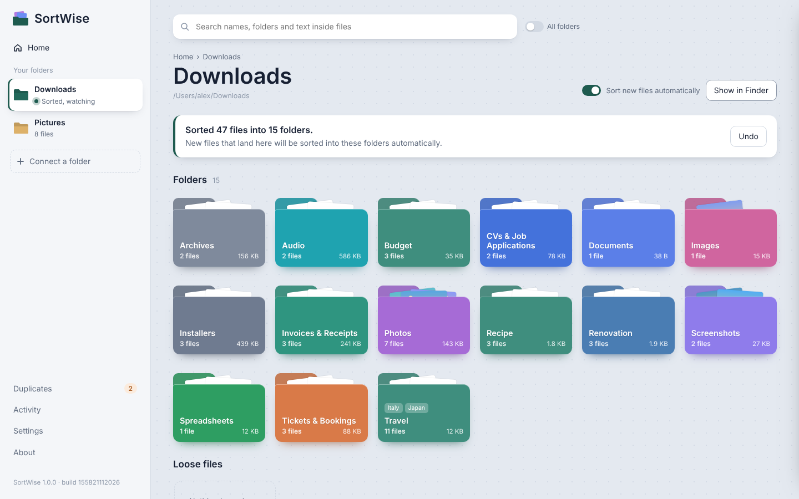

From then on, **Sort new files automatically** is on for that folder (see below).

Inside a subfolder with six or more loose files, the same button appears and works only within that subfolder.

---

## How SortWise decides where a file goes

SortWise goes by **what a file is about**, not just its type. For every loose file it reads the name and, for Word, PowerPoint, Excel, PDF and text files, the text inside. It works out the file's main subjects: the words and two-word phrases that come up most and set it apart from the other files.

It then tries these in order:

1. **An existing folder that fits.** SortWise builds a picture of each existing folder (up to six levels deep) from what the files inside it are about, plus the folder's own name. If the file's subjects match a folder closely, it goes there. SortWise keeps going down into subfolders while the match holds. For example, a new note about Kyoto goes into *Travel › Japan › Kyoto*, not just *Travel*. A folder name in the file name counts strongly: *Garden plan.docx* goes into your *Garden* folder.
2. **Special folders.** Receipts and bills go to *Invoices & Receipts*; CVs, cover letters and selection criteria to *CVs & Job Applications*; tickets and bookings to *Tickets & Bookings*; screenshots to *Screenshots*. This is based on words in the file name.
3. **A looser match with an existing folder**, if the content is close but not a strong match.
4. **A new topic folder.** Loose files that share a subject are grouped together, whatever their type. A Word document, a PDF and a slide deck about the same kitchen renovation all go into *Renovation*. A new folder needs at least 3 files (you can change this in Settings).
5. **Folders inside folders.** When a topic folder has enough files (twice the minimum), SortWise looks for sub-subjects and makes subfolders, up to four levels deep. For example: *Travel › Japan › Kyoto*. A word on almost every file in a group can't define a subfolder, because it doesn't set anything apart.
6. **By type, as a last resort.** Files with nothing to read, or no subject in common with anything, go to a folder for their type: *Documents, PDFs, Spreadsheets, Presentations, Photos, Images, Videos, Audio, Design, eBooks, Code, Archives, Installers, Fonts, Email* or *Other*. Camera photos and videos are split into year folders once there are 15 or more. SortWise reuses folders you already have with the same purpose, such as *Pictures*, *Music* or *Movies*.

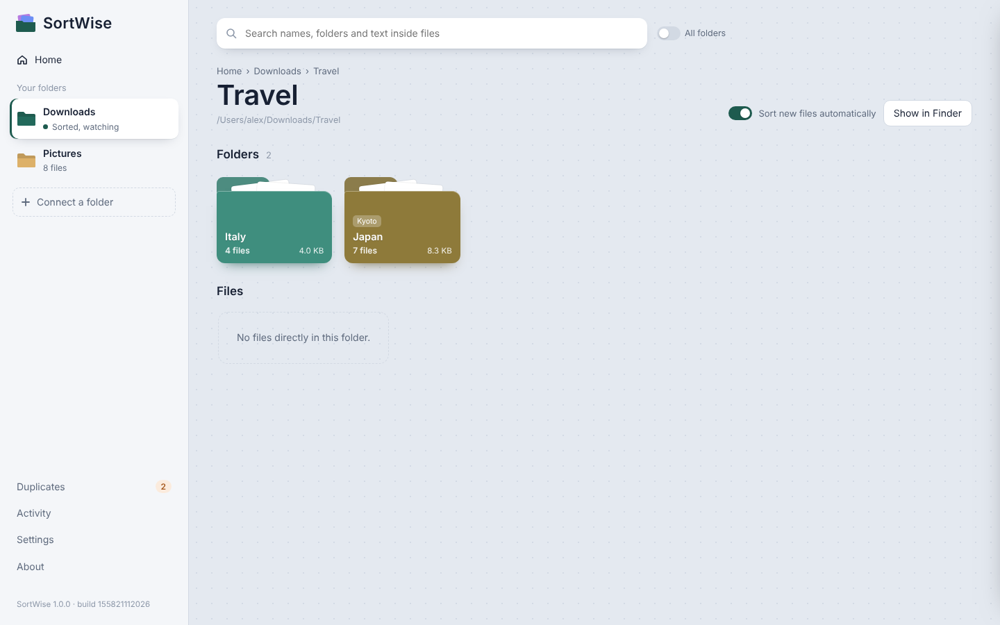

When new files arrive, SortWise only makes a new subfolder if one of the new files goes into it, so files that are already filed don't get reshuffled.

**What SortWise never moves:** shortcuts (`.lnk`, `.url`), system files (`desktop.ini`, `Thumbs.db`), hidden files, Office lock files (`~$…`), and unfinished downloads (`.crdownload`, `.part`, `.partial`, `.download`, `.tmp`). It only moves files sitting loose at the top of the folder you sort; files already in subfolders stay put.

---

## Sorting new files automatically

After you sort a folder, the **Sort new files automatically** switch is on. SortWise checks the folder every few seconds. When a new file appears, whether it's a download, a saved attachment or something you dragged in, SortWise:
- waits until the file has stopped changing for a few seconds, so downloads finish first,
- files it using the same rules as above, into the deepest folder that fits,
- makes a new topic folder when enough related files have arrived,
- and shows a notice at the bottom with an **Undo** button. Several files arriving together get one notice.

If a file is open in another app, SortWise tries again shortly.

Turn the switch off to pause automatic sorting for that folder. It only works while SortWise is running. SortWise keeps running in the tray or menu bar after you close its window, and **Start SortWise when I sign in** keeps it running after a restart.

---

## Browsing, previewing and renaming

Click a folder to open it; the path at the top lets you go back up. Click a file to open the preview panel:

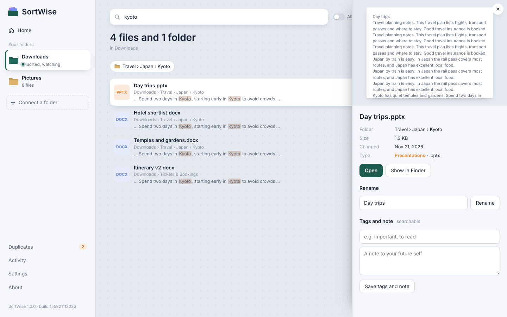

- **Preview:** pictures, videos (with playback), PDFs, and the text of Word, PowerPoint, Excel and text files.
- **Details:** folder, size, date changed and type.
- **Open** opens the file in its usual app. **Show in File Explorer** (Windows) or **Show in Finder** (Mac) shows where it is.
- **Rename:** type a new name and click **Rename**. The extension is kept for you.

For online-only OneDrive or iCloud files, SortWise asks before loading a preview, because that downloads the file.

---

## Tags and notes

In the preview panel, add **tags** (separated by commas, such as `important, to read`) and a **note**, then click **Save tags and note**. Both are searchable and stay with the file when SortWise moves it.

---

## Search

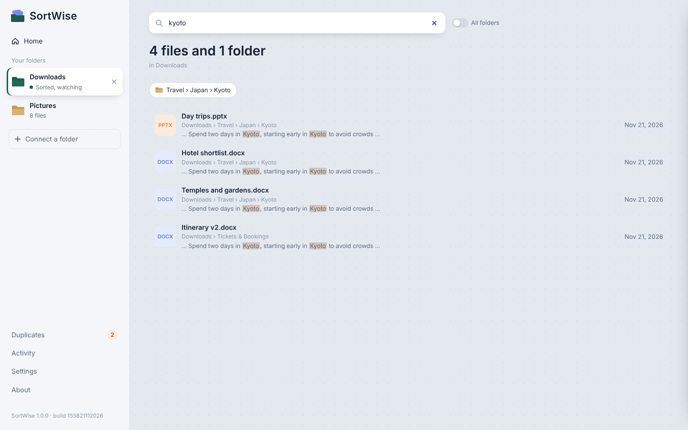

Type in the search box at the top. SortWise searches:
- file names and folder names,
- the text inside Word, PowerPoint, Excel, PDF and text files,
- your tags and notes.

Results show where each file is, plus the matching words from inside the file. Matching folders appear as chips above the file list; click one to open it.

- Words match from the start, so `kyo` finds *Kyoto*.
- Put a phrase in quotes for an exact match: `"travel insurance"`.
- Searches cover the folder you're in. Turn on **All folders** to search everything you've connected.

---

## Duplicates

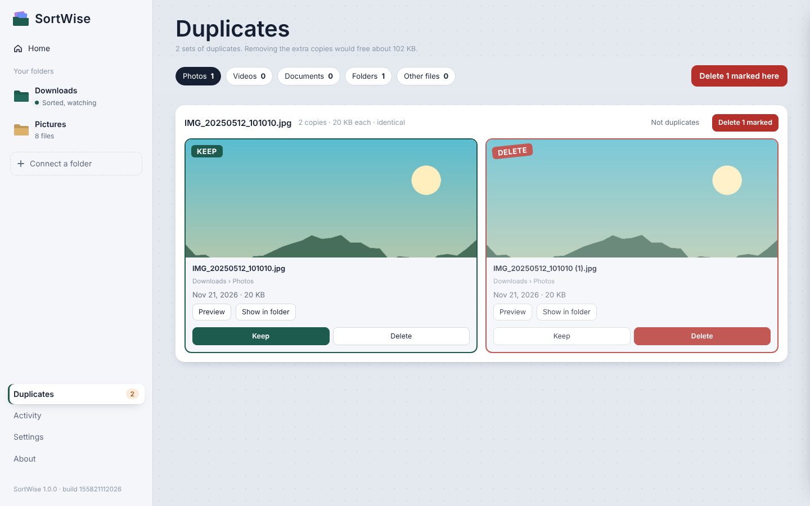

**Duplicates** lists copies across all your connected folders, sorted by how much space they waste. The tabs split them into **Photos, Videos, Documents, Folders** and **Other files**.

- Each set shows the copies side by side: photos as pictures, videos you can play, documents with their text, and folders with a look at what's inside.
- One copy is marked **Keep** and the others **Delete**. SortWise picks the copy in the best-organised place to keep, and avoids names like *(1)*, *copy* or OneDrive's *-PC-name* conflict copies. Click **Keep** or **Delete** on any copy to change it. At least one copy in each set must be kept.
- **Delete N marked** deletes the marked copies in that set. **Delete N marked here** (pinned at the top while you scroll) does every set on the current tab.
- **Not duplicates** hides a set you want to leave alone.

Deleted copies go to the **Recycle Bin** (Windows) or **Bin** (Mac), so you can still restore them.

**How copies are found.** Files are compared byte by byte, so names don't matter. Two folders count as duplicates when they contain the same files with the same sizes all the way down. Online-only cloud files can't be compared without downloading them, so they're matched by name and size and labelled that way.

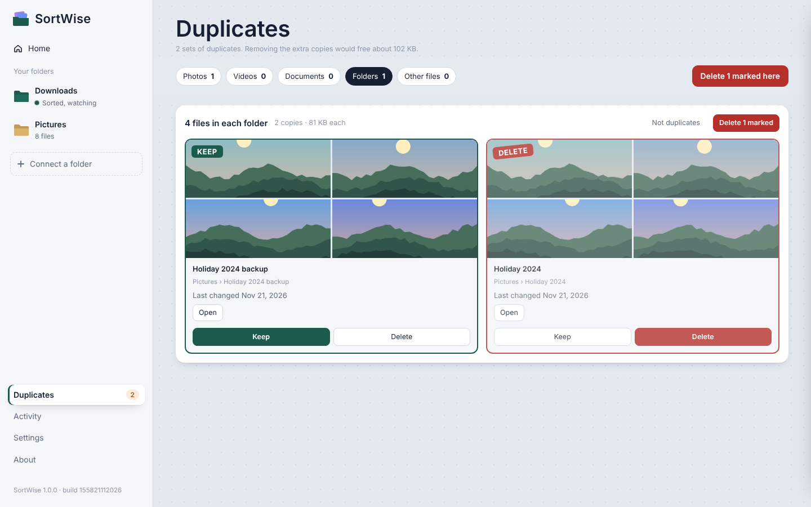

---

## Activity and undo

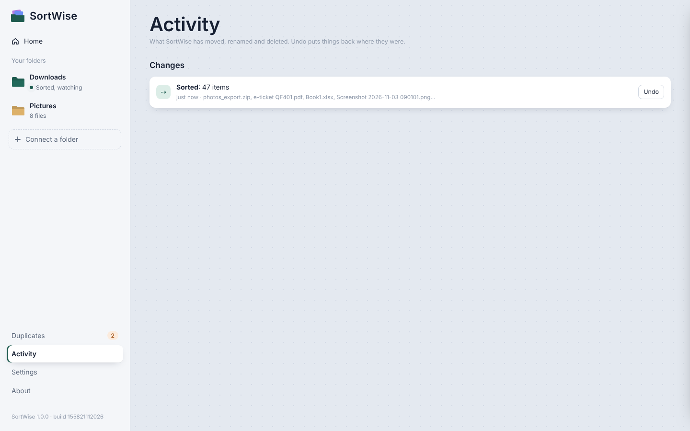

**Activity** lists:
- **Sorted automatically:** every file sorted as it arrived, and where it went.
- **Changes:** each sort, rename, automatic sort and duplicate clean-up, with how many items it covered.

**Undo** puts the files back exactly where they were and removes any folders that are left empty. Deletions can't be undone here; restore those from the Recycle Bin or Bin.

---

## Settings

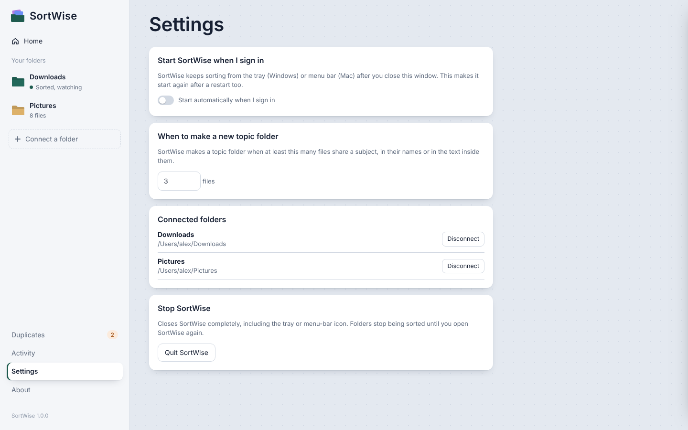

- **Start SortWise when I sign in.** Starts SortWise quietly in the tray or menu bar when you log in, so folders stay sorted.
- **When to make a new topic folder.** The number of related files needed before SortWise makes a topic folder (default 3, minimum 2). Higher numbers give fewer, bigger folders.
- **Connected folders.** Every connected folder, with **Disconnect**.
- **Quit SortWise.** Closes SortWise completely, including the tray or menu-bar icon. Folders stop being sorted until you open SortWise again.

---

## About and updates

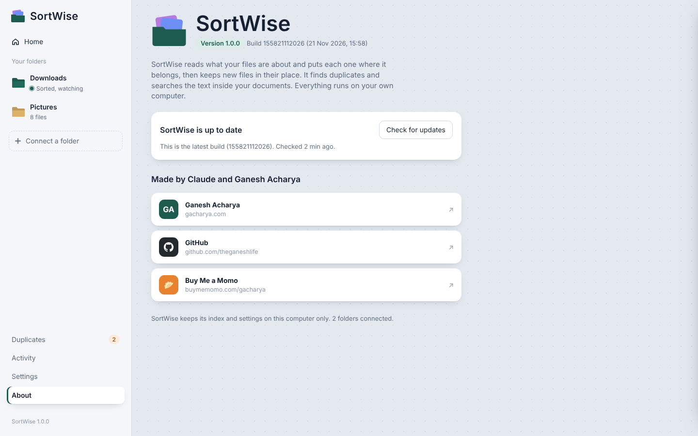

**About** shows the version and build number, the updates panel, and the credits: Claude and Ganesh Acharya, with links to gacharya.com, GitHub and Buy Me a Momo.

**Build numbers** are the time the build was published, in Sydney time, written as `HHMMDDMMYYYY`. For example, `155821112026` is 15:58 on 21 November 2026. A later time means a newer build.

**Updating.**
1. SortWise checks GitHub for a new build once a day. When one is out, **About** in the sidebar shows an **Update** badge.
2. Open **About** and click **Check for updates** (or **Update now** if a new build was already found).
3. SortWise downloads the build that matches your copy (installer, portable or Mac), closes, installs it and reopens. The window reconnects by itself.

Your connected folders, settings, tags, history and search index are kept. They live outside the app, in the folders listed under [Privacy and safety](#privacy-and-safety).

---

## The tray and menu-bar icon

SortWise keeps running in the Windows tray (bottom right, possibly under the **^** arrow) or the Mac menu bar after you close its window. The icon's menu has:
- **Open SortWise:** brings back the window. Clicking the icon on Windows does the same.
- A line showing how many folders are being sorted automatically.
- **Quit SortWise.**

Opening SortWise again from the Start menu, Desktop or Applications also brings back the window of the copy that's already running.

---

## Privacy and safety

- **Everything stays on your computer.** SortWise reads your files locally and shows its window from a local address that only your computer can reach. The only time it goes online is to check GitHub for updates and download them.
- **It never deletes on its own.** Sorting only moves files, and every move can be undone. The only deletions are duplicates you mark, and those go to the Recycle Bin or Bin.
- **Online-only files stay online.** OneDrive and iCloud placeholders aren't downloaded to read or compare them. Moving them doesn't download them either.
- **Where SortWise keeps its data:**
  - Windows: `%LOCALAPPDATA%\SortWise`
  - Mac: `~/Library/Application Support/SortWise`

  This holds the search index, settings, history and a log file (`sortwise.log`).

---

## Uninstalling

- **Windows (installed):** **Settings › Apps › Installed apps › SortWise › Uninstall**. This also removes the sign-in shortcut.
- **Windows (portable):** quit SortWise and delete the .exe.
- **Mac:** quit SortWise from the menu-bar icon and drag **SortWise** from Applications to the Bin. If you turned on starting at sign-in, also delete `~/Library/LaunchAgents/com.theganeshlife.sortwise.plist`.

To remove SortWise's index and settings too, delete the data folder listed above. Your own files and folders aren't touched by uninstalling.

---

## Troubleshooting

**Windows says "Windows protected your PC".** The app isn't code-signed. Choose **More info › Run anyway**.

**macOS says SortWise can't be opened.** Go to **System Settings › Privacy & Security**, scroll down and choose **Open Anyway**.

**Browse for a folder doesn't appear.** The folder picker may have opened behind another window. Check the taskbar or Dock. You can also paste the path into the box below it.

**A file wasn't moved.** It may be open in another app (SortWise retries), it may be one of the files SortWise never moves, or it may be inside a subfolder rather than loose at the top.

**Something went into the wrong folder.** Use **Undo** from the banner, the notice or **Activity**, or move the file yourself. SortWise learns from what's in your folders, so the more a folder contains, the better new files match it.

**Too many small folders, or too few.** Change **Settings › When to make a new topic folder**.

**Search doesn't find text in a PDF.** Scanned PDFs are images of text, so there's nothing to read. Online-only files are searchable by name only, until they're downloaded.

**The update didn't finish.** Nothing is changed when an update fails. Try **Check for updates** again, or download the latest build from [Releases](https://github.com/theganeshlife/SortWise/releases/latest) and install it over the top. Your settings are kept.

**SortWise seems stuck or a different window opens.** Quit SortWise from the tray or menu-bar icon and open it again. If an older copy is still running, a newer one closes it automatically.
